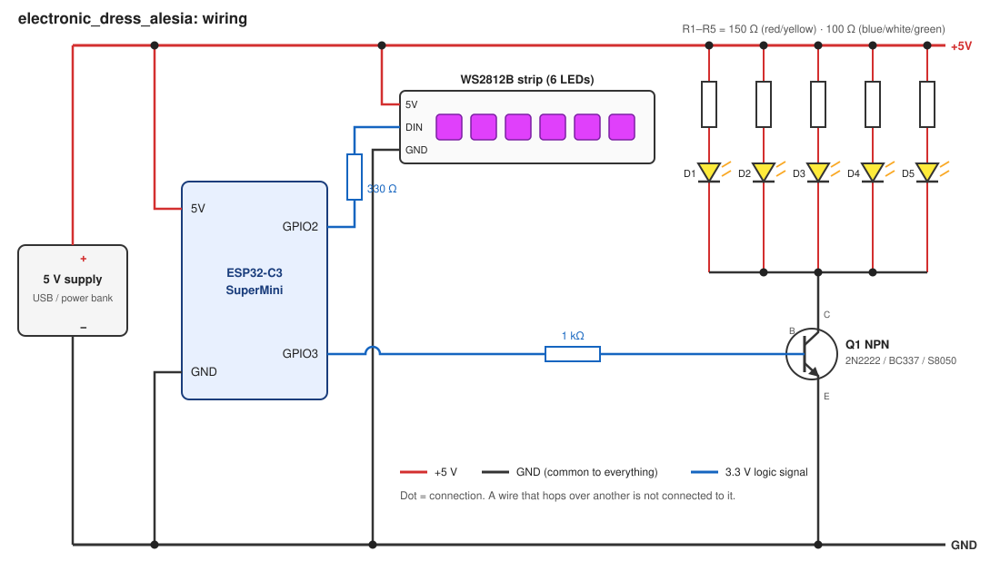

# electronic_dress_alesia

Firmware for an LED dress built on an **ESP32-C3 SuperMini**, written in **ESP-IDF** (via PlatformIO).

On boot it:

- lights a **WS2812B addressable strip** in **magenta** (data on `GPIO2`), and
- switches on **5 plain single-color LEDs** through an **NPN transistor** (base driven from `GPIO3`).

## Wiring



### Connections

| From | To | Notes |
|---|---|---|
| 5 V supply `+` | +5 V rail | USB power bank or any 5 V source |
| 5 V supply `−` | GND rail | |
| ESP32-C3 `5V` | +5 V rail | |
| ESP32-C3 `GND` | GND rail | |
| ESP32-C3 `GPIO2` | 330 Ω → strip `DIN` | Resistor close to the strip's first LED |
| Strip `5V` | +5 V rail | |
| Strip `GND` | GND rail | |
| ESP32-C3 `GPIO3` | 1 kΩ → Q1 base | |
| +5 V rail | R1…R5 → LED anodes (D1…D5) | One resistor **per** LED |
| LED cathodes (D1…D5) | Q1 collector | All 5 cathodes tied together |
| Q1 emitter | GND rail | |

### Parts

| Part | Value |
|---|---|
| Microcontroller | ESP32-C3 SuperMini |
| Addressable strip | WS2812B, 6 LEDs |
| Plain LEDs | 5 × single-color, ~20 mA each |
| Q1 | NPN, e.g. 2N2222 / BC337 / S8050 |
| LED resistors R1–R5 | 150 Ω for red/yellow (Vf ≈ 2 V), 100 Ω for blue/white/green (Vf ≈ 3 V) |
| Base resistor | 1 kΩ |
| Data-line resistor | 330 Ω |

### Why it's wired this way

- **Common ground.** Everything shares one GND. Without it the strip data and the transistor base have no reference and nothing works reliably.
- **Transistor for the plain LEDs.** 5 × 20 mA = 100 mA, far more than an ESP32 GPIO can safely supply (~20 mA). The GPIO only feeds ~2.6 mA into the base; the transistor carries the LED current from the 5 V rail.
- **One resistor per LED.** LEDs in parallel never share current evenly. Separate resistors give all five the same brightness.
- **330 Ω on the data line.** Damps ringing on the WS2812B input and protects the first LED.
- **3.3 V data into a 5 V strip.** Usually works with short wires. If the first pixel flickers, add a 74AHCT125 level shifter, or power the strip through a diode (~4.3 V) so 3.3 V counts as a solid HIGH.
- **Optional:** a 470–1000 µF capacitor across the strip's 5 V/GND at the strip input smooths power-on spikes.

### Power budget

| Load | Worst case |
|---|---|
| WS2812B, 6 LEDs, full white | 6 × 60 mA = 360 mA |
| WS2812B, 6 LEDs, magenta at brightness 80/255 | ≈ 6 × 13 mA ≈ 80 mA |
| 5 plain LEDs | ≈ 100 mA |
| ESP32-C3 | ≈ 20–80 mA |

A standard USB power bank handles this easily.

## Firmware

All the settings live at the top of [`src/main.c`](src/main.c):

```c
#define LED_GPIO         2    // WS2812B data pin
#define LED_COUNT        6    // number of pixels on the strip
#define LED_BRIGHTNESS   80   // 0..255
#define SIMPLE_LED_GPIO  3    // NPN base (through 1 kΩ) for the 5 plain LEDs
```

- The WS2812B signal is generated by the C3's **RMT** peripheral (10 MHz tick, GRB byte order), so there's no external library.
- The plain LEDs are a simple GPIO output: `HIGH` = transistor on = LEDs lit.

> Avoid `GPIO8` and `GPIO9` for anything new: they are boot strapping pins (`GPIO8` also drives the on-board LED). Safe free pins: `GPIO4`, `GPIO5`, `GPIO6`, `GPIO7`, `GPIO10`.

## Build and flash

Requires [PlatformIO](https://platformio.org/).

```sh
pio run                     # build
pio run -t upload           # flash over USB
pio device monitor          # serial log (115200)
```

Expected log output:

```
I (...) dress: Plain LEDs ON (BJT on GPIO3)
I (...) dress: Magenta on 6 LEDs, GPIO2
```

## Project layout

```
├── CMakeLists.txt        ESP-IDF project file
├── platformio.ini        PlatformIO environment (esp32c3_supermini)
├── sdkconfig.defaults    4 MB flash
├── docs/wiring.svg       wiring diagram
└── src/
    ├── CMakeLists.txt    component registration
    └── main.c            firmware
```
